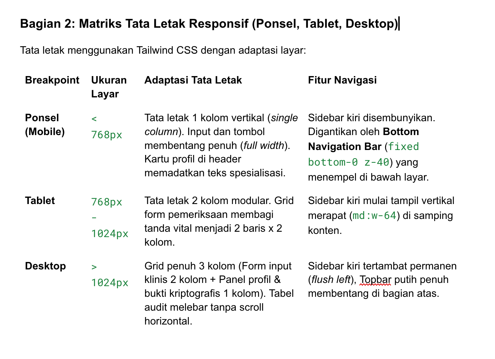

Bagian 1: Wireframe Tiga Halaman dan Kerangka Halaman Statis

Proyek ini mengimplementasikan kerangka 3 halaman hierarkis:

text
1. HALAMAN AUTENTIKASI / LOGIN (app/page.tsx)
┌──────────────────────────────────────────────────────────┐
│                      [LOGO R]                            │
│                   RESILIO-HEALTH                         │
│       Sistem Informasi Rumah Sakit & Rekam Medis         │
│  ┌────────────────────────────────────────────────────┐  │
│  │ Input Username: [ ............................. ]  │  │
│  │ Input Password: [ ••••••••••••••••••••••••••••• ]  │  │
│  │ [ TOMBOL: MASUK KE SISTEM                      ]  │  │
│  │ Akses Cepat Demo: [ Dokter ] [ Pasien ] [ Admin ]  │  │
│  └────────────────────────────────────────────────────┘  │
└──────────────────────────────────────────────────────────┘
2. HALAMAN WORKSTATION DOKTER (components/dashboard/DokterView.tsx)
┌──────────────────────────────────────────────────────────┐
│ [LOGO] RESILIO-HEALTH        │ Profil: dr. Andi [SIP:01] │
├───────────────┬──────────────────────────────────────────┤
│ SIDEBAR       │ HEADER: Formulir Pemeriksaan Pasien      │
│ - Input EHR   │ ┌──────────────────────────────────────┐ │
│ - Pasien Ward │ │ Pilih Pasien: [ Budi Santoso (P-101) ]│ │
│ - Tren Vital  │ │ Status Izin: [ Diberikan oleh Admin ]│ │
│               │ │ Keluhan: [ ......................... ]│ │
│               │ │ Tanda Vital: Tensi | Suhu | Nadi     │ │
│               │ │ Diagnosa & Resep Medis               │ │
│               │ │ [ SIMPAN & ENKRIPSI REKAM MEDIS ]    │ │
│               │ └──────────────────────────────────────┘ │
│               │ Visualisasi Grafik Fluktuasi Tanda Vital │
└───────────────┴──────────────────────────────────────────┘
3. HALAMAN KENDALI ADMIN & AUDIT (components/dashboard/AdminView.tsx)
┌──────────────────────────────────────────────────────────┐
│ [LOGO] RESILIO-HEALTH        │ Profil: Admin [ID: ADM-01]│
├───────────────┬──────────────────────────────────────────┤
│ SIDEBAR       │ FORMULIR PENUGASAN DOKTER                │
│ - Penugasan   │ Pasien: [P-101] -> Dokter: [dr. Andi]    │
│ - Audit Trail │ [ TOMBOL: TUGASKAN DOKTER SEKARANG ]     │
│ - Uji HMAC    │ ──────────────────────────────────────── │
│               │ TABEL STATUS BANGSAL                     │
│               │ ID  | Nama Pasien | Dokter PJ | Status   │
│               │ P101| Budi Santoso| dr. Andi  | Terotor. │
│               │ P102| Siti Rahma  | dr. Ratna | Terotor. │
└───────────────┴──────────────────────────────────────────┘

3. 
Web/components/ui/StatusBadge.tsx

Web/components/ui/StatCard.tsx