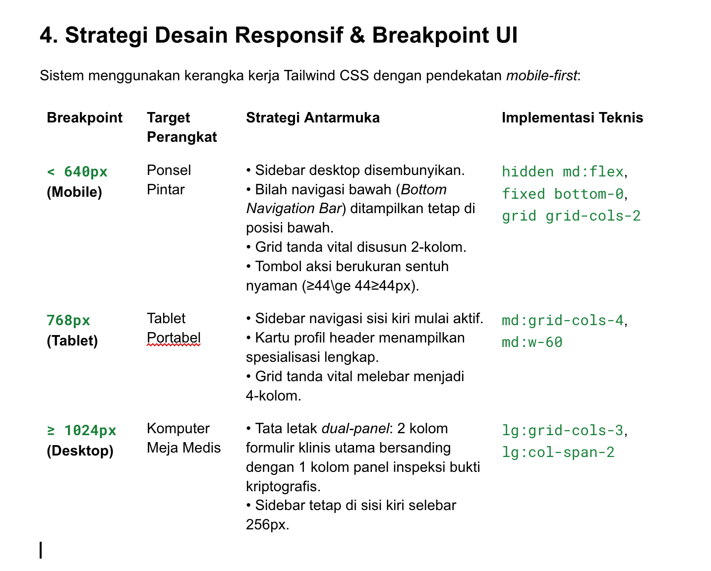

# Arsitektur Aplikasi & Keputusan Desain Antarmuka — Resilio-Health (PAW)

Dokumen ini mendokumentasikan keputusan rancangan arsitektur, hierarki komponen antarmuka, strategi tata letak responsif, serta kontrak antarmuka (*typed interface contracts*) pada sistem Resilio-Health untuk Milestone 1 (Tag `v0.1`).

---

## 1. Keputusan Rancangan Utama (*Architectural Decisions*)

### 1.1 Single-Route Role Hub (`/beranda`)
- **Keputusan**: Alur navigasi pasca-login tidak menggunakan rute terpisah (misal `/doctor-dashboard`, `/patient-portal`, `/admin-panel`), melainkan menggunakan satu rute tunggal: `/beranda`.
- **Alasan**:
  - Menyederhanakan penanganan *state* sesi dan perlindungan rute (*route guard*).
  - Merender komponen tampilan (*View Component*) secara kondisional di sisi klien berdasarkan atribut `session.role`.
  - Mencegah pengguna biasa mengakses URL panel lain secara langsung melalui *address bar*.

### 1.2 Sistem Komponen Bertipe (*Strictly Typed Components*)
- **Keputusan**: Seluruh komponen UI antarmuka wajib mendefinisikan kontrak TypeScript eksplisit (`interface Props`) dan dilarang menggunakan tipe `any` pada props publik.
- **Alasan**:
  - Menjamin kode lolos pemeriksaan `npx tsc --noEmit` tanpa galat.
  - Menjaga konsistensi data antar komponen (misal: format session, record rekam medis, badge status).

### 1.3 Pemisahan Server Component dan Client Component (Next.js App Router)
- **Keputusan**:
  - `app/layout.tsx` bertindak sebagai **Server Component** murni yang bertanggung jawab terhadap metadata dokumen HTML, konfigurasi font Google Montserrat, dan tag `lang="id"`.
  - `app/page.tsx` dan `app/beranda/page.tsx` dideklarasikan sebagai **Client Component** (`"use client"`) karena membutuhkan akses *hooks* reaktif (`useState`, `useEffect`, `useRouter`, dan API peramban `localStorage`).

---

## 2. Struktur Komponen & Aliran Data (*Component Hierarchy*)

```text
app/layout.tsx (Server Component: HTML Shell, Montserrat Font, Global CSS)
│
├── app/page.tsx (Client Component: Formulir Login & Tombol Quick Demo)
│
└── app/beranda/page.tsx (Role-Based Dynamic Hub)
    ├── components/ui/TopHeader.tsx (Header Navigasi Atas + Kartu Profil Aktif)
    │     └── components/ui/LogoutModal.tsx (Dialog Konfirmasi Keluar Aksesibel)
    │
    ├── [Role: 'dokter'] ──▶ components/dashboard/DokterView.tsx
    │     ├── components/ui/InputField.tsx (Input Berlabel Aksesibel)
    │     ├── Form Input Klinis (Keluhan, Vital, Diagnosa, Resep)
    │     ├── Visualisasi Grafik Fluktuasi Tanda Vital
    │     └── Panel Bukti Kriptografi (Ciphertext AES-GCM + Digest HMAC)
    │
    ├── [Role: 'pasien'] ──▶ components/dashboard/PasienView.tsx
    │     ├── Kartu Identitas & Kamar Pasien
    │     ├── Daftar Riwayat Rekam Medis Terenkripsi
    │     └── Tombol Dekripsi On-Demand & Verifikasi HMAC
    │
    └── [Role: 'admin']  ──▶ components/dashboard/AdminView.tsx
          ├── Tabel Delegasi Penugasan Dokter ke Pasien Bangsal
          ├── Modul Simulasi Manipulasi Data (HMAC Tamper Test)
          └── Audit Log Aktivitas Keamanan


3. Kontrak Antarmuka Komponen (TypeScript Interface Contracts)
3.1 Kontrak Sesi Pengguna (lib/auth/auth.ts)
typescript
export interface UserSession {
  id: string;              // Contoh: "DOC-01", "P-101", "ADM-01"
  username: string;        // Contoh: "dr_andi", "budi", "admin"
  name: string;            // Contoh: "dr. Andi Pratama, Sp.PD"
  role: "dokter" | "pasien" | "admin";
  specialization?: string; // Khusus dokter
  room?: string;           // Khusus pasien
}

3.2 Kontrak Entitas Rekam Medis Terenkripsi
typescript
export interface EncryptedMedicalRecord {
  recordId: string;        // ID unik record (misal: "REC-1728876543")
  patientId: string;       // ID pasien pemilik record
  doctorId: string;        // ID dokter pembuat diagnosa
  timestamp: string;       // Waktu ISO-8601 pembuatan record
  encryptedPayload: string;// Ciphertext heksadesimal hasil AES-256-GCM
  ivHex: string;           // Initialization Vector 96-bit (24 karakter hex)
  hmacDigest: string;      // Digest autentikasi HMAC-SHA256
  vitals: {
    sistolik: number;
    diastolik: number;
    suhuTubuh: number;
    detakJantung: number;
  };
}
3.3 Kontrak Komponen Reusable UI (components/ui/)

InputField:
typescript
interface InputFieldProps extends React.InputHTMLAttributes<HTMLInputElement> {
  id: string;
  label: string;
  error?: string;
  helperText?: string;
}
StatCard:
typescript
interface StatCardProps {
  title: string;
  value: string | number;
  description?: string;
  trend?: "up" | "down" | "neutral";
  icon?: React.ReactNode;
}
StatusBadge:
typescript
interface StatusBadgeProps {
  variant: "success" | "warning" | "danger" | "neutral";
  label: string;
  size?: "sm" | "md";
}



5. Strategi Aksesibilitas Web (WCAG 2.1 AA)

Semantik HTML5:
Penggunaan elemen landmark standar: <header>, <main>, <aside>, <nav>, dan <footer>.

Keterikatan Kontrol Formulir:
Seluruh elemen masukan (<input>, <textarea>, <select>) terikat secara eksplisit dengan elemen <label> melalui pasangan atribut htmlFor dan id.

Kontras Warna Teruji:
Teks gelap di atas latar belakang terang menggunakan palet Slate-900 dan Slate-600 untuk memenuhi rasio kontras ≥4.5:1 terhadap latar belakang Slate-50 dan Putih.

Navigasi Keyboard & ARIA:
Elemen interaktif memiliki focus indicator yang jelas (focus:ring-2 focus:ring-red-500).
Kontrol tanpa teks visual dilengkapi atribut aria-label deskriptif.