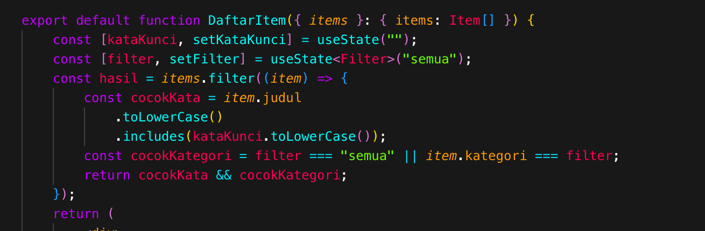
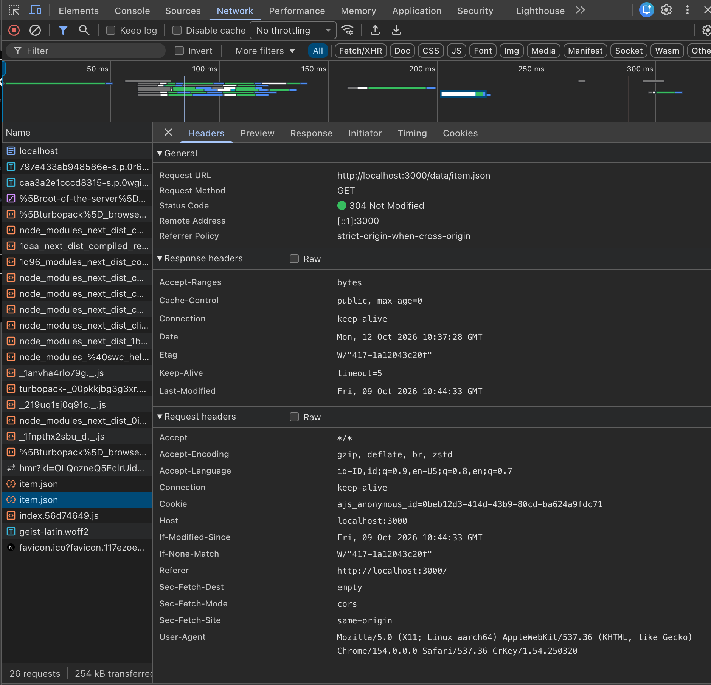
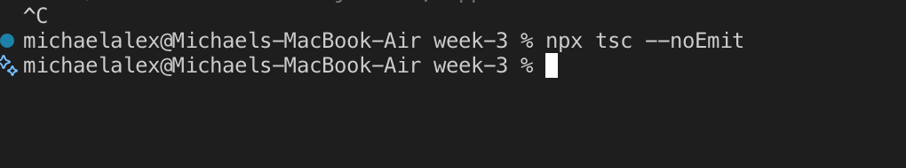
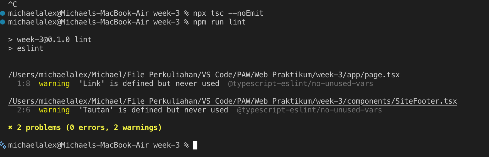

# Dokumen Teknis Modul 3 — TypeScript dan Komponen React
Nama/NIM : Michael Alexander Newton
Repositori :https://github.com/Axcelion017/PAW-Praktikum-CS5/tree/praktikum/modul-03
## 1. Tipe Data Produk
- Isi lib/tipe.ts dan alasan pemilihan union type serta properti opsional

Isi:
export type Kategori = "energi" | "lingkungan" | "kampus";
export interface Item {
 id: number;
 judul: string;
 kategori: Kategori;
 deskripsi: string;
 tersedia: boolean;
 gambar?: string;
}

Alasan: 

Penggunaan union dari string literal ("energi" | "lingkungan" | "kampus") memastikan bahwa properti kategori hanya dapat menerima salah satu dari nilai yang telah ditentukan secara pasti. Hal ini mencegah kesalahan ketik (misalnya, tidak sengaja mengetik "energy") dan memberikan keamanan tipe yang ketat, sehingga kode menjadi lebih mudah diprediksi dan di-debug. Alasan penggunaan properti opsional menggunakan tanda tanya (?) menandakan bahwa properti gambar bersifat opsional. Artinya, objek Item tetap  valid meskipun tidak menyertakan URL gambar. Hal ini memberikan fleksibilitas saat mengelola data item yang mungkin belum memiliki gambar.

## 2. Struktur Komponen
- Diagram pohon komponen akhir (Server dan Client Component)
RootLayout (app/layout.tsx) [Server Component]
├── SiteHeader (components/SiteHeader.tsx) [Server Component]
├── children (Halaman Aktif)
│   ├── Beranda (app/page.tsx) [Server Component]
│   │   └── Bagian (components/Bagian.tsx) [Server Component]
│   │       └── ItemTerbaru (components/ItemTerbaru.tsx) [Client Component - state: items, status]
│   │           └── KartuItem (components/KartuItem.tsx) [Client Component]
│   └── Katalog (app/katalog/page.tsx) [Server Component]
│       └── Bagian (components/Bagian.tsx) [Server Component]
│           └── DaftarItem (components/DaftarItem.tsx) [Client Component - state: kataKunci, filter]
│               └── KartuItem (components/KartuItem.tsx) [Client Component]
└── SiteFooter (components/SiteFooter.tsx) [Server Component]

- Tabel komponen: nama, props dan tipenya, tempat digunakan
| Nama Komponen | Props beserta Tipenya | Tempat Digunakan |
| :--- | :--- | :--- |
| `SiteHeader` | `namaProduk: string` `tautan: Tautan[]` | `app/layout.tsx` (RootLayout) |
| `SiteFooter` | `namaProduk: string` | `app/layout.tsx` (RootLayout) |
| `Bagian` | `id: string` `judul: string` `children: React.ReactNode` | `app/page.tsx` (Beranda) dan halaman lain yang membutuhkan pembungkus *section* |
| `KartuItem` | `item: Item` | Di dalam `DaftarItem.tsx` dan `ItemTerbaru.tsx` untuk menampilkan data tunggal |
| `DaftarItem` | `items: Item[]` | `app/katalog/page.tsx` (Katalog) |
| `ItemTerbaru` | Tidak menerima props (data diambil langsung di dalam komponen) | `app/page.tsx` (Beranda) |

## 3. State dan Interaksi
- Tangkapan layar tab Components (props dan state DaftarItem)

- Penjelasan alur dari event hingga render ulang
Pemicu Event (Trigger): Pengguna melakukan interaksi pada kontrol masukan di antarmuka DaftarItem, misalnya mengetik pada kolom pencarian (onChange pada input pencarian) atau memilih kategori melalui tombol filter / dropdown (onChange/onClick tombol kategori).

Pembaruan State (State Mutation): Event handler menangkap masukan nilai baru (e.target.value), lalu memanggil fungsi pengubah state seperti setKataKunci(e.target.value) atau setFilter(kategoriTerpilih).

Penjadwalan Render Ulang (Re-rendering): React mendeteksi perubahan nilai pada variabel state (kataKunci atau filter), kemudian menandai komponen DaftarItem untuk dievaluasi dan di-render ulang.

Kalkulasi Data Terfilter (Derived State): Selama proses re-render, data items dari props disaring kembali menggunakan operasi array .filter() berdasarkan nilai kataKunci dan filter yang baru.

Pembaruan DOM Riil: Komponen anak (KartuItem) diperbarui dan diselaraskan ke DOM riil secara efisien, menampilkan daftar item yang sesuai dengan kriteria filter terbaru tanpa me-reload peramban.

## 4. Pengambilan Data
- Tangkapan layar panel Network untuk permintaan item.json

- Hasil pengujian kondisi memuat, berhasil, dan gagal
Kondisi Memuat (Loading):
Pengujian: Dilakukan dengan mengamati state awal sebelum janji (Promise) fetch('/data/item.json') terselesaikan, atau melalui simulasi network throttling (Slow 3G) di Chrome DevTools.
Hasil: Tampilan menampilkan teks atau indikator placeholder memuat (misal: "Memuat data item...") dan komponen anak tidak dirender sebelum data siap.

Kondisi Berhasil (Success):
Pengujian: Berkas public/data/item.json berhasil diambil oleh peramban dengan status HTTP 200 OK.
Hasil: Respon JSON berhasil di-parse menjadi array bertipe Item[], status berubah menjadi success, dan antarmuka berhasil merender kartu-kartu item secara lengkap.

Kondisi Gagal (Error):
Pengujian: Dilakukan dengan sengaja mengubah URL endpoint fetch menjadi path yang salah (misal: /data/item-tidak-ada.json) atau mematikan koneksi peramban (Offline mode).
Hasil: Blok try...catch berhasil menangkap kesalahan, state error diperbarui, dan antarmuka menampilkan pesan galat yang ramah pengguna (misal: "Gagal memuat data item. Silakan coba lagi nanti.").

## 5. Verifikasi
- Keluaran npx tsc --noEmit dan npm run lint

## 6. Kendala dan Penyelesaian

## 7. Catatan Pemanfaatan AI
Alat: Google Antigravity / Claude 3.7 / Gemini 3.8
Perintah Utama:
"Bantu jelaskan alur perubahan state hingga re-rendering pada komponen React interaktif."
"Buat dokumentasi teknis pengujian fetch data dengan 3 kondisi: memuat, berhasil, dan gagal."

Bagian yang Digunakan:
Penjelasan alur siklus hidup React state pada Bagian 3.
Sistematika dokumentasi pengujian pengambilan data pada Bagian 4.
Poin-poin evaluasi kendala dan penyelesaian pada Bagian 6.

Cara Memverifikasinya:
Membaca dan memahami kembali penjelasan alur siklus state React sesuai dokumentasi resmi React.dev.
Memvalidasi keluaran kode dan tipe data secara langsung menggunakan perintah npx tsc --noEmit dan npm run lint.